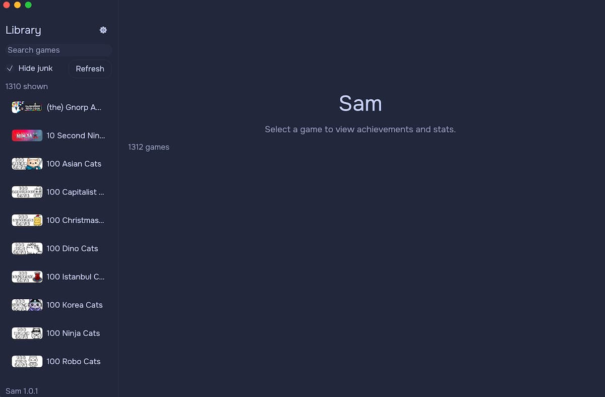
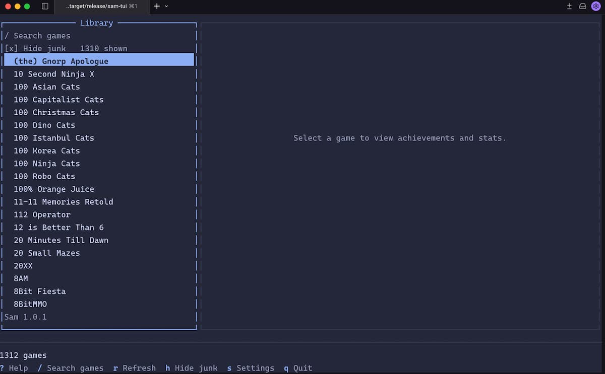

# Steam Achievement Manager For macOS 

[](https://github.com/luisitoluis/sam-macos-rs/stargazers)
[](https://github.com/luisitoluis/sam-macos-rs/forks)
[](https://github.com/luisitoluis/sam-macos-rs/pulls)
[](https://github.com/luisitoluis/sam-macos-rs/issues)
[](https://github.com/luisitoluis/sam-macos-rs/graphs/contributors)

 


A Steam Achievement Manager for macOS: a native window and a terminal UI.

Fork of [SamRewritten](https://github.com/PaulCombal/SamRewritten) with Apple Silicon and Intel builds. It uses the `steamclient.dylib` that ships with Steam for macOS. No .NET Framework.

Visit the [GitHub repository](https://github.com/luisitoluis/sam-macos-rs) to get more information.

## Installation :book:

Steam needs to be installed, opened, and signed in before the first run.

#### Homebrew

> The window. The command is `sam`:

```bash
brew install luisitoluis/tap/sam
```

> The terminal UI. The command is `sam-tui`:

```bash
brew install luisitoluis/tap/sam-tui
```

#### Script

> The installers download the prebuilt binary for your Mac from the [latest release](https://github.com/luisitoluis/sam-macos-rs/releases/latest) and check it against `checksums.txt`. No Rust needed. If a release has no binary for your Mac, the installer builds it from source.

- Window. `Sam.app` goes in `~/Applications`, so it opens from Launchpad, Spotlight, or Finder. The command is `sam`:

```bash
/bin/bash -c "$(curl -fsSL https://raw.githubusercontent.com/luisitoluis/sam-macos-rs/master/scripts/install.sh)"
```

- Terminal UI. The command is `sam-tui`:

```bash
/bin/bash -c "$(curl -fsSL https://raw.githubusercontent.com/luisitoluis/sam-macos-rs/master/scripts/install-tui.sh)"
```

> Settings go in front of the command:

| Variable | Effect |
| --- | --- |
| `SAM_METHOD=source` | Always build from source. `binary` never falls back. |
| `SAM_VERSION=v1.0.2` | Install that release instead of the latest. |
| `SAM_BIN_DIR=/path` | Put the `sam` / `sam-tui` command somewhere other than `~/.local/bin`. |
| `SAM_APP_DIR=/path` | Put `Sam.app` somewhere other than `~/Applications`. |

```bash
SAM_METHOD=source /bin/bash -c "$(curl -fsSL https://raw.githubusercontent.com/luisitoluis/sam-macos-rs/master/scripts/install.sh)"
```

#### Uninstall

> Each script removes only that install. The cloned source in `~/.sam` and the `PATH` line go too, once the other one is already gone.

- Window (`Sam.app` and `sam`):

```bash
/bin/bash -c "$(curl -fsSL https://raw.githubusercontent.com/luisitoluis/sam-macos-rs/master/scripts/uninstall.sh)"
```

- Terminal UI (`sam-tui`):

```bash
/bin/bash -c "$(curl -fsSL https://raw.githubusercontent.com/luisitoluis/sam-macos-rs/master/scripts/uninstall-tui.sh)"
```

> `SAM_PURGE=1` in front of either command deletes the shared cache and settings only when the other install is already gone.

- Homebrew, the window, then the terminal UI:

```bash
brew uninstall sam
brew uninstall sam-tui
```

#### Browser download

> Sam is not notarized by Apple. A copy downloaded from the releases page with a browser is blocked the first time ("Apple could not verify Sam..."). This applies to both `Sam.app` and `sam-tui`. Homebrew and the scripts download with `curl`, which does not trigger this.

After extracting the archive, either run:

```bash
xattr -dr com.apple.quarantine Sam.app sam-tui
```

or try to open each one once (`./sam-tui` from Terminal for the TUI), then go to **System Settings → Privacy & Security** and click **Open Anyway**.

#### Build from source

> Rust is only required for this path:

```bash
curl --proto '=https' --tlsv1.2 -sSf https://sh.rustup.rs | sh
```

```bash
git clone https://github.com/luisitoluis/sam-macos-rs.git
cd sam-macos-rs
```

- Both, written to `target/release/Sam.app` and `target/release/sam-tui`:

```bash
cargo build --release
```

- Only the window, or only the terminal UI:

```bash
cargo build --release --bin sam --no-default-features --features gui
cargo build --release --bin sam-tui --no-default-features --features cli
```

> `Sam.app` opens without Terminal. Cargo still writes the bare `sam` executable next to it, but it is hidden in Finder because double-clicking it would open Terminal. Drag `Sam.app` to `~/Applications` to keep it.

`sam-tui --version` prints the installed version.

## Usage :gear:

- `sam` opens the window.
- `sam-tui` opens the terminal UI.

Steam has to have been launched once so `steamclient.dylib` exists.

## How it works :wrench:

The macOS Steam client ships a universal (arm64 and x86_64) `steamclient.dylib`. Sam:

1. Finds it at `~/Library/Application Support/Steam/Steam.AppBundle/Steam/Contents/MacOS/steamclient.dylib`
2. Loads it with `dlopen`
3. Talks to the running Steam client through the same interfaces SamRewritten uses on Linux

A Linux `steamclient.so` is still picked up as a fallback if the dylib is missing.

## Troubleshooting :sos:

#### "Steam connection failed"

> Open Steam and sign in before starting Sam.

#### "Could not find steam client library"

```bash
open -a Steam
```

```bash
export SAM_STEAMCLIENT_PATH="$HOME/Library/Application Support/Steam/Steam.AppBundle/Steam/Contents/MacOS/steamclient.dylib"
```

#### "Failed to open library"

> Launch Steam once so it can create the library files.

#### Intel Macs

> Binaries are published for every release, but untested.

## License

GPL-3.0. See [LICENSE](LICENSE).

## Contributors 👑

<a href="https://github.com/luisitoluis/sam-macos-rs/graphs/contributors">
  
</a>
